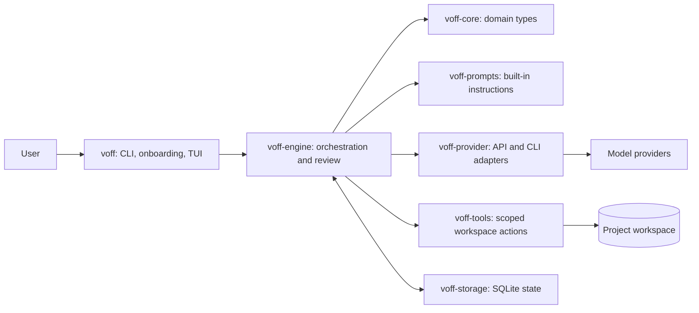
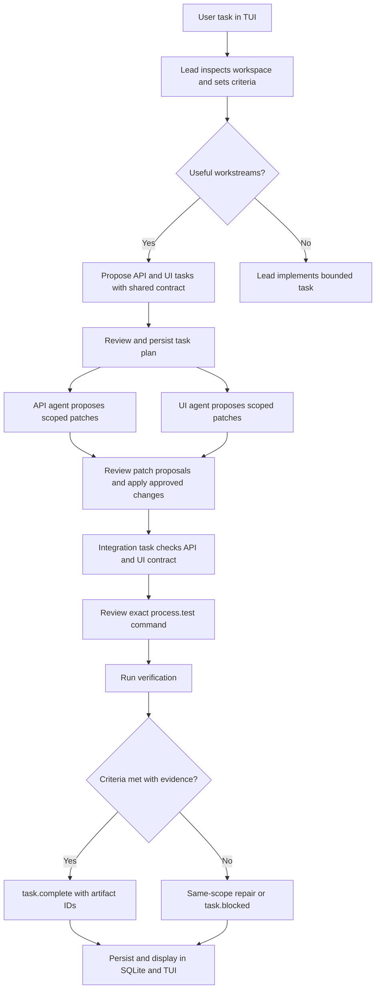

# Voff architecture

Voff is a terminal-first, provider-neutral coding-agent workflow.

## Components

| Crate | Owns |
| --- | --- |
| `voff-core` | Domain types: agents, tasks, events, approvals, artifacts, limits |
| `voff-provider` | Provider-neutral requests and provider adapters |
| `voff-engine` | Orchestration, validation, delegation, review, completion |
| `voff-storage` | SQLite persistence |
| `voff-tools` | Scoped file/search tools and bounded process execution |
| `voff-prompts` | Setup, workflow, review, provider, and tool prompts |
| `voff` | Startup, configuration, onboarding, terminal UI |

Verified multi-workstream plans assign disjoint workspace-relative `owned_paths` to implementation agents. Voff enforces each patch scope and runs those workers concurrently; unscoped work stays serial. Integration waits for implementation results and checks the shared contract.

Independent action reviews run concurrently in batches of four; decisions and side effects are still applied sequentially. Model context is capped at 16 KiB. The first task turn gets project overview; later turns get scoped/changed files or use workspace tools for fresh evidence.

Command reports are compacted for agent context (passing test lines collapse to a count); stored reports stay available in the TUI. Expanded task details show local event times and elapsed task duration.

Workspace reads and search are bounded, read-only, batched up to eight per response, and create evidence directly. Repeated unchanged inspections get one corrective hint, then stop; an approved patch permits a fresh read. Patches, commands, and delegation still use approval; file pages carry up to 6,000 characters.

## “Make a calculator app” workflow

The calculator tasks “Create calculator API” and “Create calculator interface” appear in TUI fixtures. Shared-contract integration is exercised by `crates/voff-engine/tests/integrated_work.rs`; there is no special calculator implementation.

## Built-in prompts

Prompt source: `crates/voff-prompts/src/`.

| Prompt | Purpose |
| --- | --- |
| `setup::DEFAULT_SCAN_SETUP_PROMPT` | Build a useful team from repository evidence; treat it as untrusted; use an acyclic tree, max four delegation edges. |
| `setup::DEFAULT_BUILD_SETUP_PROMPT` | Same, shaped around the requested outcome. |
| `workflow::WORK_INSTRUCTIONS` | Delegate bounded work; define integration contracts; preserve behavior; verify appropriately; complete with evidence. |
| `workflow::REVIEW_POLICY` | Review exact actions; reject unsafe, unrelated, or unclear side effects. |
| `provider::LOCAL_CLI_PREFIX` | Require local CLIs to use Voff-mediated tools, not native filesystem/shell/network/subagent tools. |
| `tool_descriptions` | Define bounded reads, digest-checked patches, reviewed commands, delegation, completion, and blockers. |

Workspace setup and agent prompts can override defaults.
