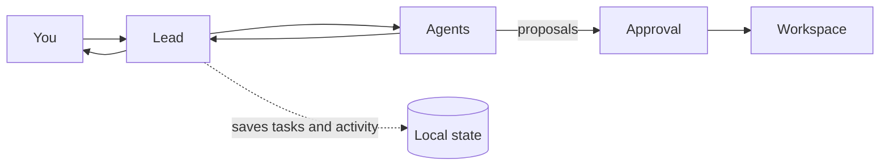

<p align="center">
  
  <br>
  <b>Workflow builder for coding agents 🐶</b>
  <br><br>
  <a href="https://github.com/orhun/voff/releases"></a>
  <a href="https://www.rust-lang.org/"></a>
  <a href="LICENSE-MIT"></a>
  <br>
  <a href="https://crates.io/crates/voff"></a>
  <a href="https://github.com/orhun/voff/actions/workflows/ci.yml"></a>
</p>

<p align="center">
  
</p>

Watch tasks move from plan to implementation with coordinated coding agents! 🦴

1. Create a team of agents automatically based on your project.
2. Assign a task and have agents implement it in parallel.
3. Watch the workflow unfold live!

<details>
  <summary>Table of Contents</summary>

<!-- vim-markdown-toc GFM -->

- [Quickstart](#quickstart)
- [Features](#features)
  - [How it works](#how-it-works)
    - [Why use a team workflow?](#why-use-a-team-workflow)
- [Usage](#usage)
  - [Key bindings](#key-bindings)
  - [Available tools](#available-tools)
- [Configuration](#configuration)
- [Logo](#logo)
- [License](#license)
- [Copyright](#copyright)

<!-- vim-markdown-toc -->

</details>

## Quickstart

If you have Rust/Cargo installed:

```
cargo install voff
```

Then simply run `voff` in your project directory!

Other installation methods:

- Arch Linux: `pacman -S voff`

## Features

- Mix providers and models from **Codex**, **Claude**, and **Ollama** in one team.
- Delegate through nested teams and run independent tasks in parallel.
- Track token usage and per-agent cost estimates.

### How it works



#### Why use a team workflow?

**Q:** Why not just ask a single agent to do everything?  
**A:** A team splits independent work across agents and runs it in parallel. The lead checks each result against its acceptance criteria, requests fixes where needed, and integrates the verified work. **Voff gives you a coordinated, visible workflow with built in reviews.**

## Usage

Run `voff --setup [PROJECT_DIR]` to start team setup again for an existing project. It ignores the saved team and keeps the project's task history.

### Key bindings

| Key               | Action                          |
| ----------------- | ------------------------------- |
| `1` / `2` / `Tab` | Switch between tabs             |
| `Enter`           | Send a task to the lead         |
| `t`               | Focus the team map or task pane |
| `a`               | Add an agent                    |
| `o`               | Open the selected agent's tab   |
| `j` / `k`         | Browse agents                   |
| `?`               | Open Help                       |

Key hints appear in the interface. Press `?` to see all shortcuts.

### Available tools

Available tools depend on the agent:

| Tool             | What it does                    |
| ---------------- | ------------------------------- |
| `file.read`      | Read project files              |
| `search.text`    | Search project text             |
| `file.patch`     | Propose a file edit             |
| `process.test`   | Propose a local command         |
| `task.delegate`  | Assign work to team agents      |
| `review.request` | Request an agent review         |
| `task.complete`  | Report completion with evidence |
| `task.blocked`   | Report why work cannot continue |

Commands cannot request network access, installation, publication, deployment or destructive actions.

## Configuration

After setup, Voff saves the team to `.voff/config.toml` and this file can be edited to customize the team.

The following is an example configuration:

```toml
workspace = ".."

[[agent]]
name = "Lead"
provider = "codex_cli"
model = "default"
prompt = "Plan the work, delegate tasks, and review the results."
max_output_tokens = 32768

[[agent]]
name = "Implementer"
provider = "claude_cli"
model = "default"
prompt = "Implement the assigned task and report changes and checks."
reports_to = "Lead"
max_output_tokens = 16384

[[agent]]
name = "Reviewer"
provider = "ollama"
model = "qwen2.5-coder"
prompt = "Review the implementation against its acceptance criteria."
reports_to = "Lead"

[setup_prompts]
scan_workspace = "Inspect this project and suggest a useful agent team."
build_from_description = "Create a team for the user's project description."
```

## Logo

Meet **Pasha** 🧡 Voff's mascot and unofficial moral supporter.


## License

[](./LICENSE-MIT)
[](./LICENSE-APACHE)

Licensed under either of [Apache License Version 2.0](./LICENSE-APACHE) or [The MIT License](./LICENSE-MIT) at your option 🐶

🦀 ノ( º \_ º ノ) - respect crables!

## Copyright

Copyright © 2026, [Orhun Parmaksız](mailto:orhunparmaksiz@gmail.com)
