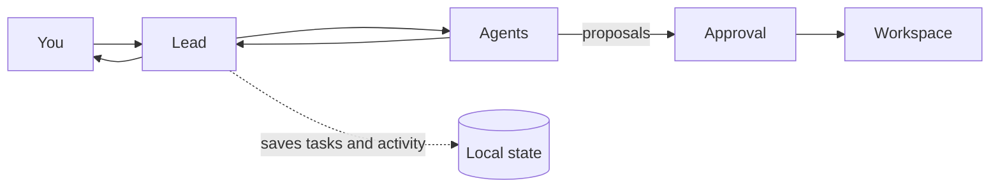

<p align="center">
  
  <br>
  <b>Workflow builder for coding agents 🐶</b>
  <br><br>
  <a href="https://github.com/orhun/voff/releases"></a>
  <a href="https://www.rust-lang.org/"></a>
  <a href="LICENSE-MIT"></a>
</p>

voff runs coding agents as a team. A lead assigns tasks, agents do the work, and you can review changes and commands before they run. Tasks and activity are saved locally.

## Getting started

Requires [Rust 1.92+](https://www.rust-lang.org/tools/install) and one provider:

- Codex CLI (`codex`)
- Claude CLI (`claude`)
- [Ollama](https://ollama.com/)
- An OpenAI API key
- An Anthropic API key

From the repository root:

```sh
cargo install --path crates/voff
cd ~/path/to/project
voff
```

Choose a provider and model. Then scan the project or describe the team you want. Team settings go in `.voff/config.toml`; task history goes in `.voff/voff.db`.

You can also start voff for a specific directory or load a team configuration directly:

```sh
voff ~/path/to/project
voff --config .voff/config.toml
```

Voff loads `.voff/config.toml` automatically when it exists.

## How it works



File access and commands stay within the workspace. File changes and local commands need approval. Commands run without a shell and have time and output limits.

## Why use a team workflow?

Voff keeps planning, implementation, and checks visible:

- Split work into tasks and assign them to named agents.
- Run independent tasks in parallel; send results to the lead for review.
- Review file changes and local commands before approval.
- Use different providers for different agents.
- Reopen the project with its saved team and task history.

## Available tools

Available tools depend on the agent:

| Tool             | What it does                                                                                                        | Limits and review |
| ---------------- | ------------------------------------------------------------------------------------------------------------------- | ----------------- |
| Tool             | Use                                                                                                                 |
| ---              | ---                                                                                                                 |
| `file.read`      | Read workspace text files in 1,200-character pages. Sensitive paths are blocked.                                    |
| `search.text`    | Search workspace files with a bounded result count.                                                                 |
| `file.patch`     | Propose a file change. Approval is required to apply it.                                                            |
| `process.test`   | Propose a local command. It runs without a shell, from the workspace, with a five-minute timeout and capped output. |
| `task.delegate`  | Assign tasks to enabled direct reports.                                                                             |
| `review.request` | Ask an enabled agent to review task evidence.                                                                       |
| `task.complete`  | Report completion with evidence. A patch alone is not enough.                                                       |
| `task.blocked`   | Report a blocker.                                                                                                   |

Commands cannot request network access, installation, publication, deployment, or destructive actions.

## Team configuration

Teams use TOML. The first agent is the lead. Other agents report to the lead unless `reports_to` names another agent.

```toml
workspace = ".."

[[agent]]
name = "Lead"
provider = "codex_cli"
model = "default"
prompt = "Plan the work, delegate tasks, and review the results."
max_output_tokens = 32768

[[agent]]
name = "Implementer"
provider = "claude_cli"
model = "default"
prompt = "Implement the assigned task and report changes and checks."
reports_to = "Lead"
max_output_tokens = 16384

[[agent]]
name = "Reviewer"
provider = "ollama"
model = "qwen2.5-coder"
prompt = "Review the implementation against its acceptance criteria."
reports_to = "Lead"

[setup_prompts]
scan_workspace = "Inspect this project and suggest a useful agent team."
build_from_description = "Create a team for the user's project description."
```

### Configuration fields

| Field                                  | Meaning                                                                                       |
| -------------------------------------- | --------------------------------------------------------------------------------------------- |
| `workspace`                            | Workspace directory. Relative to the TOML file. A command-line directory takes precedence.    |
| `agent[].name`                         | Unique agent name. The first agent is the team lead.                                          |
| `agent[].provider`                     | `codex_cli`, `claude_cli`, `ollama`, `openai`, or `anthropic`. `codex`, `claude`, `open_ai`, and `claude_api` also work. |
| `agent[].model`                        | Model name. Defaults to the provider's default model.                                         |
| `agent[].prompt`                       | Agent instructions. `system_prompt` is an alias.                                              |
| `agent[].reports_to`                   | Reporting agent. Defaults to the lead.                                                        |
| `agent[].max_output_tokens`            | Response limit. Defaults to `16384`; range is `1`–`1000000`.                                  |
| `setup_prompts.scan_workspace`         | Prompt used to suggest a team from a workspace.                                               |
| `setup_prompts.build_from_description` | Prompt used to build a team from your description.                                            |

Credentials are not stored in the TOML file. Use the provider CLI login, an environment variable, or the in-app prompt. OpenAI and Anthropic credentials entered in the app are saved in the local database. Set `OPENAI_API_KEY` or `ANTHROPIC_API_KEY` to use a cloud API provider.

Voff saves generated teams to `.voff/config.toml`. Edit the file by hand or load one with `--config`.

## Navigation

| Key                 | Action                                          |
| ------------------- | ----------------------------------------------- |
| `1` / `2`           | Open Team / Tasks                               |
| `Tab` / `Shift+Tab` | Switch tabs                                     |
| `Enter`             | Write a task                                    |
| `t`                 | Switch focus between the team map and task pane |
| `h`                 | Show or hide the task pane                      |
| `u`                 | View token usage and cost estimates             |
| `w`                 | Choose another workspace                        |

In Team, press `a` to add an agent and `o` to open its tab. Select an agent to edit its settings. Press `?` for help.

## License

Licensed under either the [MIT license](LICENSE-MIT) or [Apache License, Version 2.0](LICENSE-APACHE), at your option.
