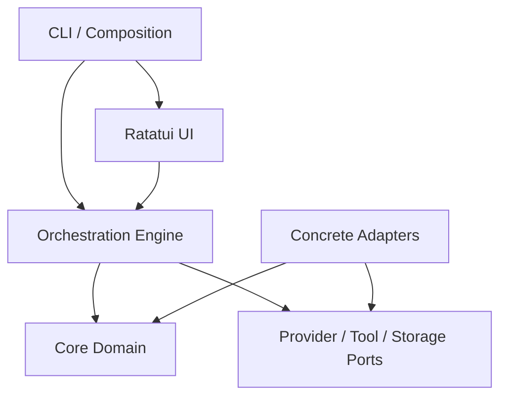
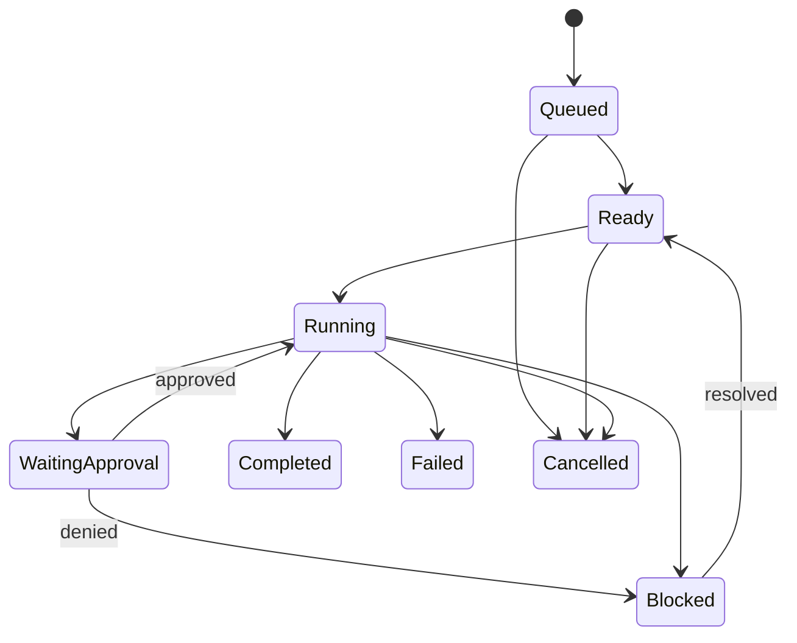

# Technical Architecture

## 1. Architecture style

Use a layered, event-driven Rust workspace with ports and adapters. The domain and orchestration engine must compile and test without Ratatui, a network connection or real provider credentials.

## 2. Proposed workspace

```text
crates/
  agentmux-core/          # IDs, entities, state machines, policies, events
  agentmux-engine/        # scheduler, delegation, budgets, cancellation
  agentmux-provider/      # provider traits and canonical streaming events
  agentmux-providers/     # concrete adapters, separated by module/feature
  agentmux-tools/         # tool contracts, authorization and built-ins
  agentmux-executor/      # process and workspace execution boundaries
  agentmux-storage/       # repository traits, SQLite and artifact store
  agentmux-config/        # schema, validation, loading and migration
  agentmux-tui/           # Ratatui application, views and input mapping
  agentmux-cli/           # binary, commands, startup and dependency wiring
```

Crates may initially be combined if Phase 0 demonstrates that boundaries create needless overhead, but core/provider/TUI separation is mandatory.

## 3. Dependency direction



Adapters implement inward-facing traits. Core must not depend on adapters, SDKs, Ratatui or SQLite.

## 4. Core domain model

Suggested typed identifiers:

- `SessionId`
- `AgentId`
- `FormationId`
- `TaskId`
- `MessageId`
- `ToolCallId`
- `ApprovalId`
- `ArtifactId`
- `EventId`

Key aggregates:

- `Session`: workspace, formation snapshot, status, budgets
- `AgentProfile`: role, model reference, prompt reference, permissions
- `Task`: graph relationships, owner, criteria, limits, state
- `ToolCall`: proposed input, authorization, execution and result
- `Approval`: scope, decision, actor and expiry
- `Artifact`: type, location, digest, producer and metadata

## 5. Task state machine



Persist transitions as events and store a current-state projection. Validate every transition in the domain layer.

## 6. Provider port

Conceptual interface:

```rust
#[async_trait]
pub trait ModelProvider: Send + Sync {
    fn descriptor(&self) -> ProviderDescriptor;
    async fn models(&self) -> Result<Vec<ModelDescriptor>, ProviderError>;
    async fn start(
        &self,
        request: CanonicalRequest,
        sink: ProviderEventSink,
        cancellation: CancellationToken,
    ) -> Result<ProviderCompletion, ProviderError>;
}
```

`CanonicalRequest` carries normalized messages, tool definitions, structured-output schema and limits. Provider-specific payloads never escape the adapter.

The exact-pinned Rig provider crates are an implementation detail of
`agentmux-providers`. Rig agent/run/tool types must not cross into core, engine,
tools, executor, storage, TUI, or CLI contracts. AgentMux remains the source of
truth for task state, approvals, tool execution, budgets, and audit history; no
Rig run or effect state is persisted.

Provider events include text delta, reasoning-status metadata when legally/technically exposed, tool request, usage update, warning, completion and error. Do not depend on private chain-of-thought.

## 7. Orchestration engine

Model turns execute through the provider-neutral `AgentRuntime` port. During the
Rig migration a compatibility runtime wraps `ModelProvider`; future Rig runtime
implementations must suspend and return tool proposals to the engine rather
than executing tools. See ADR 0020.

Responsibilities:

- Validate and persist task commands
- Resolve dependencies and ready queues
- Enforce concurrency and budgets
- Start/cancel provider runs
- Validate structured tool/delegation requests
- Coordinate approvals
- Emit canonical UI/storage events
- Recover interrupted sessions

Use an actor-like event loop or command handler with bounded channels. State-changing commands should be serialized per session. Provider streams and processes may run concurrently but report through canonical events.

## 8. Scheduler

- Fair queue by session, then priority and creation time.
- Per-provider and global concurrency semaphores.
- Dependency-aware readiness.
- Explicit retry policies by error class.
- No recursive function that directly launches unbounded child agents.
- Cancellation tokens per session, task and tool call.

## 9. Workspace and integration model

MVP default: one project root, read access shared, writes serialized through patch proposals.

Recommended write flow:

1. Agent reads a workspace snapshot/version.
2. Agent proposes a patch artifact.
3. Engine checks path scope and compares the base digest.
4. Non-overlapping, permitted changes may be applied.
5. Stale or overlapping changes go to integration/review.

Post-MVP isolation may use Git worktrees or sandboxed workers. Do not let multiple agents write the same checkout concurrently without coordination.

## 10. Storage

- SQLite in WAL mode for sessions, profiles, tasks, messages, events, approvals and usage.
- Content-addressed files for large outputs/artifacts.
- Transactions for task transition plus corresponding event.
- Schema migrations embedded and tested.
- Sensitive request bodies redacted or optionally excluded.
- Provider wire fixtures are deterministic test replay data, not the canonical
  audit log. Do not introduce a second durable effect log without an ADR and a
  migration/recovery design.

Suggested tables:

`sessions`, `agents`, `formation_snapshots`, `tasks`, `task_dependencies`, `messages`, `tool_calls`, `approvals`, `artifacts`, `events`, `usage_records`, `schema_migrations`.

## 11. TUI architecture

- `AppModel`: UI projection only, derived from engine events.
- `Action`: normalized keyboard/command intent.
- `Effect`: async request sent to the engine.
- Render functions are pure and fast.
- Background tasks send bounded events; coalesce high-frequency streaming deltas.
- Virtualize long lists and cap in-memory scrollback.

Suggested main layout:

```text
Top: session, formation, budget, provider health
Left: task/dependency tree
Center: selected task events/conversation
Right: agents, tools, artifacts or inspector
Bottom: command input, shortcuts and status
```

## 12. Configuration precedence

`CLI flags > environment references > workspace config > user config > built-in defaults`.

Secrets are resolved at runtime and are never serialized into a formation snapshot.

## 13. Error taxonomy

Normalize errors into:

- Configuration
- Authentication
- Authorization/policy
- Rate limit
- Timeout/transient provider
- Invalid provider response
- Tool/executor
- Storage/conflict
- Budget exceeded
- Cancelled
- Internal invariant violation

Each error declares retryability and a user-action hint.

## 14. Testing strategy

- Unit tests for transitions, policies, graph validation and budgets
- Property tests for acyclic task graphs and transition invariants
- Contract tests shared by all provider adapters
- Integration tests using mock provider, temporary workspace and SQLite
- TUI reducer/input tests and selected snapshots
- Recovery tests with injected interruption points
- Security tests for path traversal, secret redaction and denied commands

## 15. Architectural decision records

Material changes require `docs/adr/NNNN-title.md` with context, decision, alternatives and consequences. First ADRs should cover provider abstraction, event persistence, workspace write model and process sandbox strategy.
